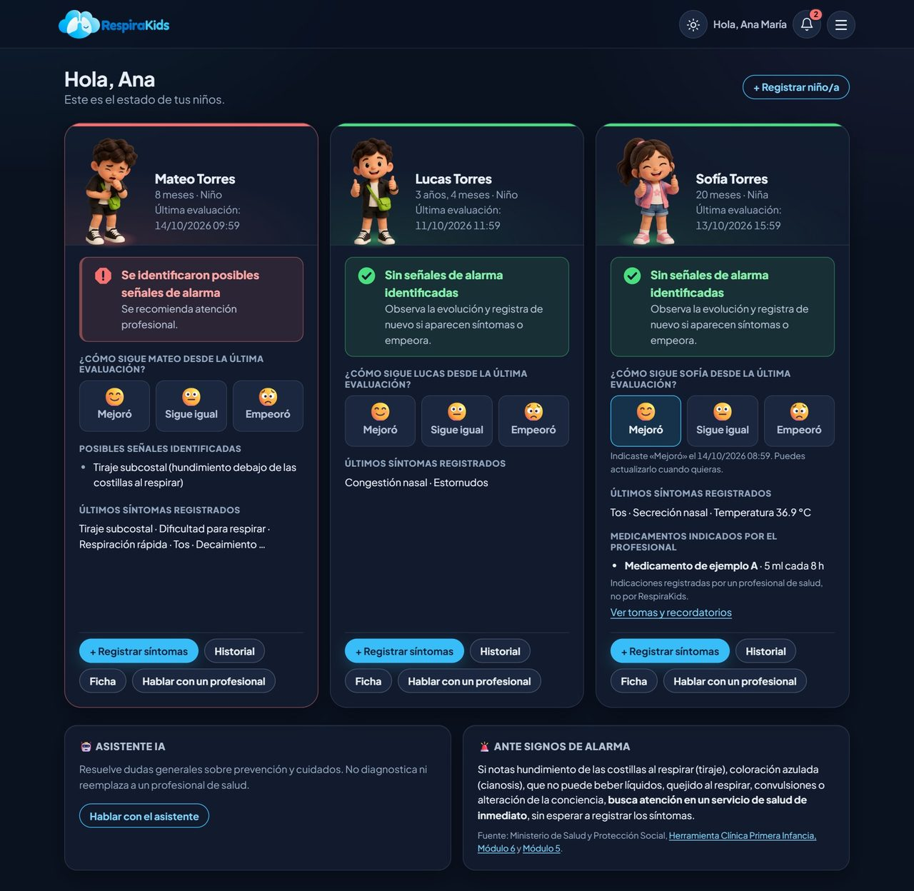
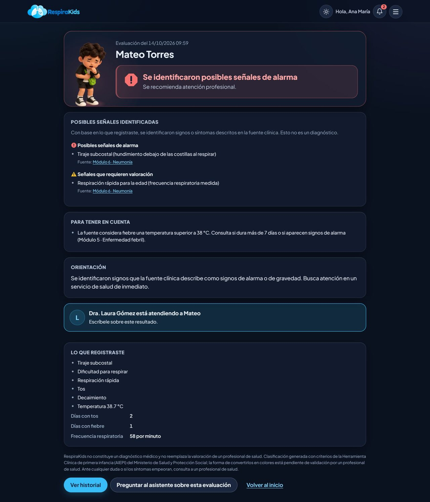
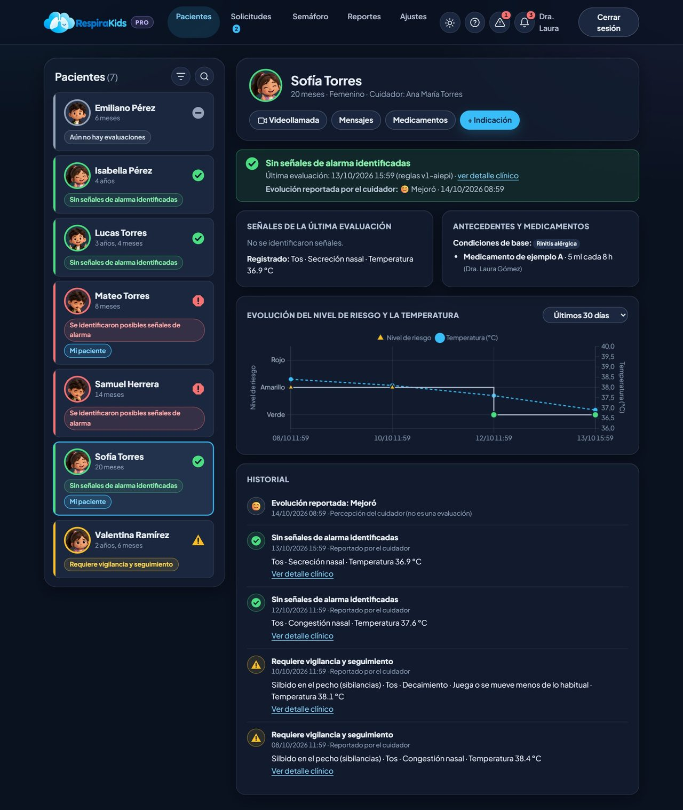
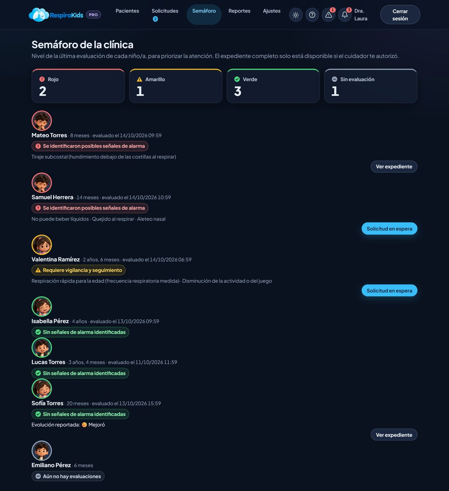
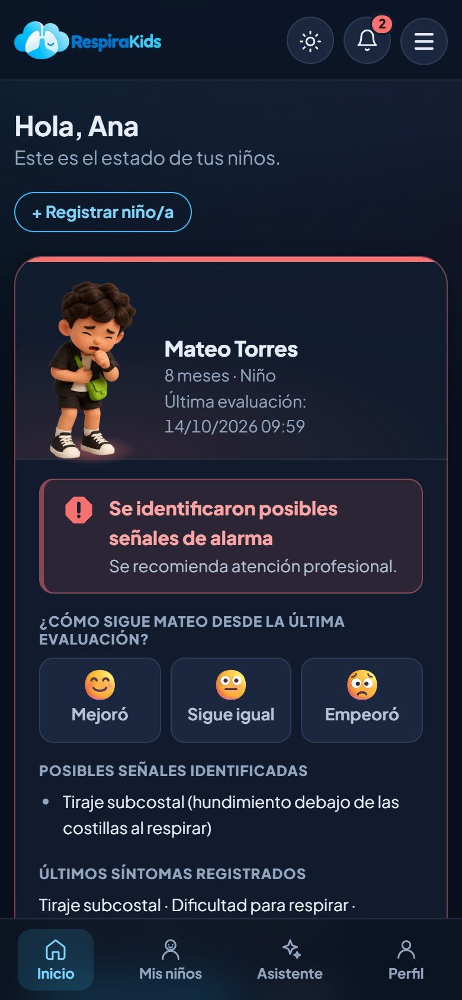
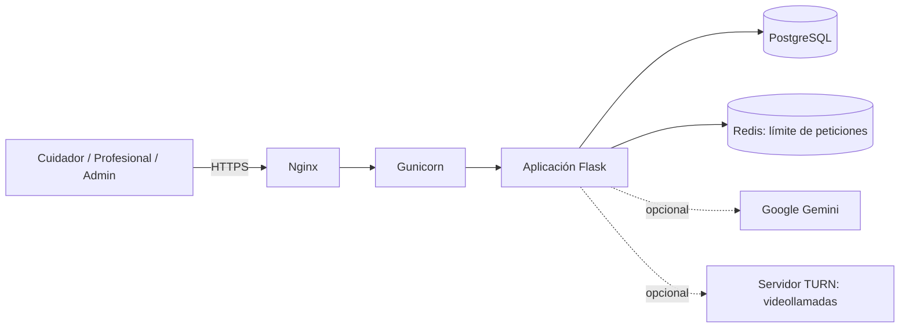

# RespiraKids

Plataforma web para el **seguimiento de enfermedades respiratorias en niños menores de 5 años**. Los cuidadores registran los síntomas y reciben una clasificación tipo semáforo (verde, amarillo, rojo) calculada con las reglas clínicas de la *Herramienta Clínica de Primera Infancia (AIEPI)* del Ministerio de Salud de Colombia. Los profesionales de salud ven el expediente de los niños que sus cuidadores les autorizan y pueden atenderlos por mensajes o videollamada.

> **Proyecto académico, no es un dispositivo médico.** RespiraKids no diagnostica ni reemplaza la valoración de un profesional de salud. Los datos de las capturas de este documento son ficticios.

<p align="center">
  
</p>

## Qué problema resuelve

Ante una infección respiratoria, muchos cuidadores no saben si el cuadro de su hijo es de observación o de consulta urgente, y los profesionales no tienen un resumen ordenado de la evolución del niño. RespiraKids convierte el registro de síntomas en una orientación comprensible para el cuidador y en un expediente claro para el profesional, citando siempre el módulo de la fuente clínica que respalda cada señal.

## Capturas

| Resultado de una evaluación | Expediente del profesional |
|---|---|
|  |  |

| Semáforo de la clínica | Vista en celular |
|---|---|
|  |  |

## Funcionalidades

**Para cuidadores**
- Registro de varios niños, con antecedentes y condiciones de base.
- Formulario de síntomas con evaluación inmediata, señales detectadas y fuente clínica de cada una.
- Seguimiento de la evolución («Mejoró / Sigue igual / Empeoró»), historial y gráficos.
- Mensajes con el profesional, adjuntos privados y videollamada.
- Medicamentos indicados por el profesional, con tomas y recordatorios.
- Asistente de IA (Google Gemini) limitado a orientación general, con base de conocimiento sanitario propia.
- Control de privacidad: autoriza o retira el acceso de cada profesional por niño, descarga o solicita la supresión de sus datos.

**Para profesionales**
- Lista de pacientes ordenada por nivel de riesgo y semáforo de toda la clínica.
- Expediente con evolución, detalle clínico de cada evaluación y señales identificadas.
- Solicitudes de atención con cupo por profesional, mensajería y videollamada.
- Indicación de medicamentos, reportes y alertas.

**Para administradores**
- Aprobación de profesionales, gestión de cuentas, auditoría de seguridad y de acceso a datos de niños.
- Reglas clínicas vigentes, base de conocimiento del asistente y ficha del modelo de aprendizaje automático.

## Arquitectura



La aplicación es un monolito modular: cada área es un *blueprint* de Flask con sus rutas, y la lógica de negocio vive en servicios reutilizables y probables por separado.

```
app/
├── auth/  dashboard/  pacientes/  sintomas/    # rutas por área (blueprints)
├── mensajes/  videollamadas/  medicamentos/
├── asistente/  privacidad/  admin/  ayuda/
├── clinica/        # motor clínico: reglas v1-aiepi, fuentes, documentación
├── ml/             # entrenamiento y predicción del modelo complementario
├── models/         # SQLAlchemy: identidad, niños, clínica, comunicación, privacidad, auditoría
├── services/       # acceso, consentimiento, atención, auditoría, supresión, anonimización...
└── templates/ static/
migrations/         # Alembic (14 versiones)
deploy/             # Nginx, systemd, scripts de respaldo y actualización
docs/               # reglas clínicas, seguridad, despliegue, acta de validación
ml/                 # ficha y datos del modelo experimental
tests/              # pytest
```

### Motor clínico (decisión de diseño central)

La clasificación **la deciden reglas, no un modelo de aprendizaje automático**:

- Las reglas viven en `app/clinica/reglas_v1.py`, están **versionadas** (`v1-aiepi`) y cada evaluación guarda con qué versión se calculó y qué señales la produjeron, así que un resultado es reproducible y auditable.
- Cada señal enlaza al módulo de la fuente clínica que la respalda.
- El nivel final es el más alto de las señales detectadas (rojo > amarillo > verde); un registro sin señales no se presenta como «sano», solo como «sin señales de alarma identificadas».
- En producción, el sistema exige declarar explícitamente la versión de reglas validada por un profesional de salud (`REGLAS_CLINICAS_VALIDADAS`). La validación de las 26 reglas por un médico general se documenta en `docs/VALIDACION_REGLAS_v1-aiepi_ACTA.md`: la hoja está firmada, y la confirmación escrita y el registro profesional del firmante siguen pendientes.

### Aprendizaje automático complementario (experimental)

Un `RandomForestClassifier` (scikit-learn) apoya al profesional con una segunda opinión estadística. **Se entrenó con datos sintéticos** generados con las mismas reglas, por lo que mide qué tanto las imita, no qué tan bien predice en niños reales. No modifica la clasificación, no se muestra a los cuidadores y viene apagado por defecto en producción. Métricas, distribución de clases y huella SHA-256 en [`ml/MODELO_ML.md`](ml/MODELO_ML.md).

### Seguridad y privacidad

Pensada para datos de salud de menores bajo la Ley 1581 de 2012 (Colombia). El inventario completo, con dónde se implementa cada medida y qué prueba la cubre, está en [`docs/SEGURIDAD_Y_CUENTAS.md`](docs/SEGURIDAD_Y_CUENTAS.md). En resumen:

- Roles y acceso por niño (un id ajeno responde 404), consentimiento por niño y derechos del titular.
- Contraseñas con hash, bloqueo tras 5 intentos, enlaces de correo de un solo uso guardados como hash SHA-256.
- CSRF, cabeceras de seguridad (Talisman), cookies `HttpOnly`/`Secure`/`SameSite`/`__Host-`, límite de peticiones.
- Adjuntos de mensajes en una carpeta privada fuera de `/static` y de git.
- Auditoría de seguridad y de cada acceso a datos de niños.

## Tecnologías

| Capa | Tecnología |
|---|---|
| Backend | Python 3.14, Flask 3, SQLAlchemy, Alembic, Flask-Login, Flask-WTF, Flask-Mail, Flask-Limiter, Flask-Talisman |
| Base de datos | PostgreSQL (SQLite en memoria para pruebas) |
| IA | Google Gemini (asistente), scikit-learn (modelo complementario) |
| Videollamadas | WebRTC con servidor TURN propio, sin grabación |
| Servidor | Gunicorn, Nginx, systemd, Redis |
| Calidad | pytest, GitHub Actions (migraciones y pruebas sobre PostgreSQL), `pip-audit` |

## Cómo ejecutarlo en tu equipo

Requisitos: Python 3.14 y PostgreSQL.

```bash
git clone https://github.com/jovenesdevanguardia/respirakids.git
cd respirakids
python -m venv venv
# Windows: venv\Scripts\activate    ·    Linux/macOS: source venv/bin/activate
pip install -r requirements-dev.txt

cp .env.example .env        # completa SECRET_KEY y DATABASE_URL (ver comentarios del archivo)
flask --app wsgi db upgrade # crea las tablas
python seed_data.py         # datos ficticios de demostración (no corre en producción)
python run.py               # http://localhost:5000
```

Las cuentas de demostración que crea `seed_data.py` y sus contraseñas están en ese archivo. Sin `GEMINI_API_KEY` el asistente queda desactivado y sin `MAIL_SERVER` los correos se escriben en el log en lugar de enviarse.

## Pruebas

```bash
pytest -q
```

La suite cubre autenticación, acceso por rol y por niño, motor clínico, privacidad y supresión de datos, mensajes y adjuntos, videollamadas, formularios, modo producción y flujos completos de cuidador y profesional. La integración continua (`.github/workflows/ci.yml`) aplica las migraciones desde cero sobre PostgreSQL y ejecuta las pruebas en cada push y pull request.

## Despliegue

Guía paso a paso para un VPS Linux (Nginx, Gunicorn, systemd, PostgreSQL, Redis, TLS, respaldos y restauración) en [`docs/DESPLIEGUE.md`](docs/DESPLIEGUE.md); los archivos de configuración están en `deploy/`.

## Documentación

| Documento | Contenido |
|---|---|
| [`docs/REGLAS_CLINICAS_v1.md`](docs/REGLAS_CLINICAS_v1.md) | Reglas clínicas y su fuente |
| [`docs/VALIDACION_REGLAS_v1-aiepi_ACTA.md`](docs/VALIDACION_REGLAS_v1-aiepi_ACTA.md) | Acta de validación de las reglas |
| [`docs/SEGURIDAD_Y_CUENTAS.md`](docs/SEGURIDAD_Y_CUENTAS.md) | Inventario de seguridad y protección de datos |
| [`docs/DESPLIEGUE.md`](docs/DESPLIEGUE.md) | Instalación en producción |
| [`ml/MODELO_ML.md`](ml/MODELO_ML.md) | Ficha del modelo experimental |

## Estado y límites

- Es un proyecto de grado. Las 26 reglas clínicas fueron revisadas por un médico general (acta con pendientes, ver arriba), pero la plataforma no ha pasado por una validación clínica con pacientes reales ni cumple (aún) los requisitos regulatorios de un dispositivo médico.
- El modelo de aprendizaje automático es experimental y usa datos sintéticos.
- Antes de operar con usuarios reales deben completarse los datos del responsable del tratamiento (variables `RESPONSABLE_*`).

## Autoría

Proyecto de grado de la Corporación Universitaria Rafael Núñez, 2026. Desarrollo de software: Bayron Vásquez Castillo. Investigador principal: Alex Pájaro de Ávila, Semillero de Investigación de Enfermería SINENFER, Universidad del Sinú, Seccional Cartagena.
